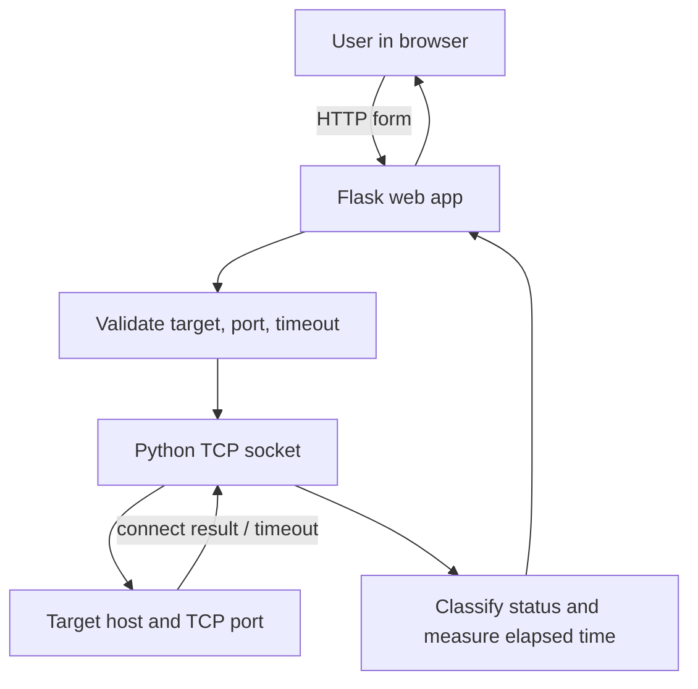

# Socket-Based Port Availability Checker

A Computer Networks mini-project built with Python sockets and Flask. It checks TCP connection availability for localhost/private-network targets and reports status plus elapsed connection-attempt time.

## Features
- Single TCP port check.
- Bounded range check (up to 100 ports per request).
- Results: Open, Closed, Timeout, or Error.
- Latency measurement in milliseconds.
- Input validation and timeout controls.
- Responsive browser UI.
- Unit tests using a temporary local TCP listener.
- Local/private target restriction for responsible educational use.

## Requirements
- Python 3.10 or newer (Python 3.12 recommended)
- VS Code (or any editor)
- macOS, Windows, or Linux

## Setup on macOS
Open this folder in VS Code, then choose Terminal → New Terminal.

```bash
python3.12 -m venv .venv
source .venv/bin/activate
python -m pip install --upgrade pip
pip install -r requirements.txt
```

If your Python command is not `python3.12`, use a supported Python version to create the virtual environment.

## Run
```bash
python app.py
```
Open http://127.0.0.1:5001 in your browser. Keep the terminal open while using the site. Stop the server with Control+C.

If port 5001 is occupied, run:
```bash
flask --app app run --port 5002
```
Then open http://127.0.0.1:5002.

## Test
```bash
python -m pytest -v
```

## Demo suggestions
1. Start the app.
2. Check `127.0.0.1`, port `5001` while this Flask app is running. It should be open.
3. Check a likely unused local port, e.g. `127.0.0.1:54321`; it will often report Closed, but the result depends on your machine.
4. Try a short range such as ports 5000–5010 and review the counts and elapsed time.
5. Capture screenshots and record your actual results in the report. Do not invent performance measurements.

## Architecture


## Protocol and message format
The application uses TCP connection establishment. The checker calls `connect_ex()` on a TCP socket. A successful connection is reported as Open. A refused connection is reported as Closed. No response before the configured timeout is reported as Timeout. A timeout may indicate filtering or reachability issues and does not prove a port is closed. This project does not send an application-level message payload.

## Performance methodology
For each attempt, the app measures elapsed wall-clock time around the TCP connect operation with `time.perf_counter()`. Range total time is the sum of individual attempt times. For your report, run multiple trials under the same conditions and record actual numbers:
- target and port range
- timeout setting
- number of trials
- open/closed/timeout counts
- measured per-attempt latency and total elapsed time
- network conditions and limitations

Do not claim a specific throughput or latency until you have measured it.

## Test cases
| Test | Procedure | Expected interpretation |
|---|---|---|
| Open port | Run app, check localhost:5001 | Open |
| Closed port | Check an unused localhost port | Usually Closed |
| Invalid port | Enter 0 or 70000 | Validation error |
| Invalid hostname | Enter a nonexistent hostname | Resolution error |
| Timeout | Test an authorized private host that silently drops connections | Timeout may occur |
| Range limit | Request more than 100 ports | Validation error |
| Range summary | Check 5000–5010 | Results and counts displayed |

## Limitations
- TCP only; no UDP support.
- Connection availability is not the same as service health.
- Results depend on firewalls, routing, host state, and timeout.
- Range checks are sequential, so elapsed time increases with range size.
- Limited to localhost/private-network targets by design.
- Use only on systems you own or have permission to test.

## Viva preparation
**What is a port?** A logical endpoint used by transport protocols to identify an application/service on a host.

**What is a socket?** An operating-system communication endpoint identified by address family, socket type, and protocol.

**TCP vs UDP?** TCP is connection-oriented and provides reliable ordered byte-stream delivery; UDP sends datagrams without a connection handshake.

**What does Open mean here?** A TCP connection attempt succeeded at that moment.

**Does Closed always mean the machine is down?** No. A refusal often indicates that the host was reachable but no service accepted that TCP port. A timeout is ambiguous.

**What is latency?** Here, elapsed time for the connection attempt, measured in milliseconds; it is not a general network RTT benchmark.

**Why use a timeout?** To prevent a connection attempt from waiting indefinitely.

**What is a limitation?** Firewalls and transient network conditions can affect classification.

## Individual contribution
Complete this section honestly for your submission:
- Name:
- Features implemented by me:
- Tests run by me:
- Challenges and solutions:
- What I learned:
# CN-CCA-3 Youtube Link
**https://youtu.be/8QdXVmwPDy0?si=rnCU6VGaCuDTZrqf

